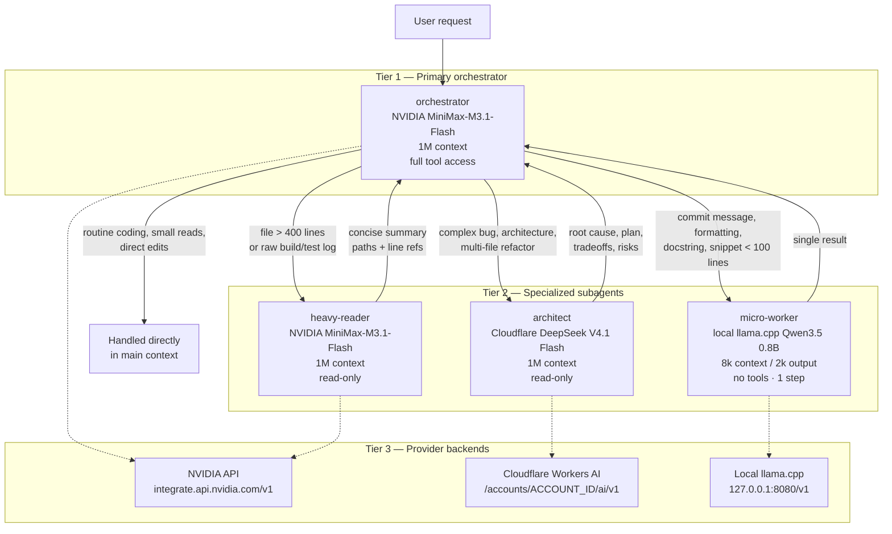

# Three-Tier Subagent Architecture

An example [OpenCode](https://opencode.ai) configuration for routing work across a primary orchestrator and three specialized subagents.

The goal is to protect the main context window:

- Large files and raw logs go to a **reader** subagent.
- Deep reasoning goes to an **architect** subagent.
- Trivial single-step work goes to a **local micro-worker**.
- Routine coding stays with the primary orchestrator.

See [model-architecture.md](model-architecture.md) for the full routing diagram and provider details.

## Architecture



## Routing summary

| Route | Trigger | Agent | Model | Returns | Guardrails |
|---|---|---|---|---|---|
| Main | Routine coding, small reads, direct edits | `orchestrator` | NVIDIA MiniMax-M3.1-Flash | Direct work | Full tools |
| Large read | File > 400 lines or raw build/test logs | `heavy-reader` | NVIDIA MiniMax-M3.1-Flash | Concise summary with paths/line refs | No edit, shell, or subagent |
| Deep reasoning | Complex bugs, architecture, multi-file refactors | `architect` | Cloudflare DeepSeek V4.1 Flash | Root cause, plan, tradeoffs, risks | No edit, shell, or subagent |
| Trivial work | Commit messages, formatting, docstrings, snippets < 100 lines | `micro-worker` | Local Qwen3.5 0.8B | Single result | No tools, one step |

The three subagents are siblings. `orchestrator` is the only router, and no subagent can spawn another subagent.

## Repository contents

| File | Purpose |
|---|---|
| `opencode.json.example` | Native OpenCode V2 configuration with providers and agents |
| `model-architecture.md` | Detailed diagram, routing rules, topology, and provider mapping |
| `README.md` | Project overview and setup instructions |

## Quick start

```bash
cp opencode.json.example opencode.json

export NVIDIA_API_KEY="..."
export CLOUDFLARE_ACCOUNT_ID="..."
export CLOUDFLARE_API_TOKEN="..."

opencode
```

The configuration uses environment-variable references, so no credentials are stored in the file.

## Requirements

- [OpenCode](https://opencode.ai) with native V2 configuration support
- NVIDIA API Catalog key for MiniMax-M3.1-Flash
- Cloudflare Workers AI account and API token for DeepSeek V4.1 Flash
- A Workers Paid plan for the Cloudflare model
- A local `llama.cpp` server for `micro-worker`

## Local worker

The example expects:

- Endpoint: `http://127.0.0.1:8080/v1`
- Model ID: `ggml-org/Qwen3.5-0.8B-GGUF:BF16`
- Context: 8,192 tokens
- Output: 2,048 tokens

Adjust `modelID`, `limit.context`, and `limit.output` in `opencode.json` to match your server.

## Validation

```bash
python3 -m json.tool opencode.json.example >/dev/null

mkdir -p /tmp/opencode-config-check
cp opencode.json.example /tmp/opencode-config-check/opencode.json
(cd /tmp/opencode-config-check && opencode debug config && opencode debug agents)
```

## Security

- Only environment-variable placeholders are committed.
- `.gitignore` excludes `opencode.json`, `.env`, and local secrets.
- Do not commit real API keys or account IDs.
