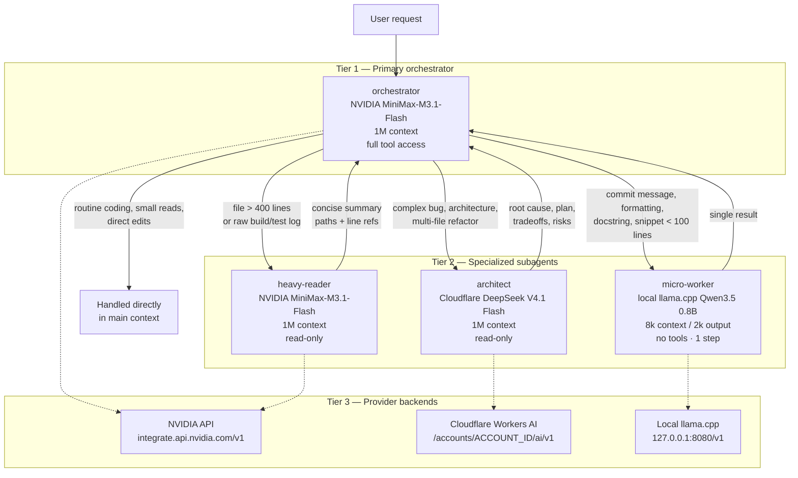

# Three-Tier Subagent Routing Architecture

This document describes how `opencode.json.example` routes work between the primary orchestrator and its specialized subagents.

## Diagram



## Routing summary

| Route | Trigger | Agent | Model | Returns | Guardrails |
|---|---|---|---|---|---|
| Main | Routine coding, small reads, direct edits | `orchestrator` | NVIDIA MiniMax-M3.1-Flash | Direct work | Full tools |
| Large read | File > 400 lines or raw build/test logs | `heavy-reader` | NVIDIA MiniMax-M3.1-Flash | Concise summary with paths/line refs | No edit, shell, or subagent |
| Deep reasoning | Complex bugs, architecture, multi-file refactors | `architect` | Cloudflare DeepSeek V4.1 Flash | Root cause, plan, tradeoffs, risks | No edit, shell, or subagent |
| Trivial work | Commit messages, formatting, docstrings, snippets < 100 lines | `micro-worker` | Local Qwen3.5 0.8B | Single result | No tools, one step |

## Routing rules

1. **Protect the main context**
   - Never read files larger than 400 lines or raw build/test logs in the primary session.
   - Delegate those reads to `heavy-reader` and use only its concise summary.
   - Check file size first when large files are suspected.

2. **Isolate deep reasoning**
   - Delegate complex bugs, architecture decisions, and multi-file refactor plans to `architect`.
   - Provide the problem statement, relevant paths, and constraints.
   - Keep the detailed reasoning out of the main context.

3. **Offload trivial work**
   - Delegate commit messages, formatting, simple docstrings, and summaries of snippets under 100 lines to `micro-worker`.
   - Prompts must be single-step and fully self-contained because `micro-worker` has no tools.

4. **Handle routine work directly**
   - The orchestrator keeps routine coding, small reads, and direct edits.
   - Work that does not match a delegation rule stays in the main context.

## Topology

The three subagents are **siblings**, not a chain:

```text
User
  |
  v
orchestrator
  |-- heavy-reader
  |-- architect
  `-- micro-worker
```

`orchestrator` is the only router. None of the subagents can spawn another subagent.

## Provider mapping

| Provider | Endpoint | Authentication | Used by |
|---|---|---|---|
| NVIDIA API Catalog | `https://integrate.api.nvidia.com/v1` | `NVIDIA_API_KEY` | `orchestrator`, `heavy-reader` |
| Cloudflare Workers AI | `https://api.cloudflare.com/client/v4/accounts/{env:CLOUDFLARE_ACCOUNT_ID}/ai/v1` | `CLOUDFLARE_API_TOKEN` | `architect` |
| Local llama.cpp | `http://127.0.0.1:8080/v1` | None | `micro-worker` |

## Activation notes

- Copy `opencode.json.example` to `opencode.json` so OpenCode loads the configuration.
- Set `NVIDIA_API_KEY`, `CLOUDFLARE_ACCOUNT_ID`, and `CLOUDFLARE_API_TOKEN`.
- The Cloudflare `deepseek-v4.1-flash-1017` model requires a Workers Paid plan.
- The local worker assumes the model ID `ggml-org/Qwen3.5-0.8B-GGUF:BF16` at `127.0.0.1:8080`.
- Adjust the local context and output limits to match your llama.cpp server configuration.
